

<h1>People</h1>
<section class="pi-profile" aria-labelledby="pi-name">
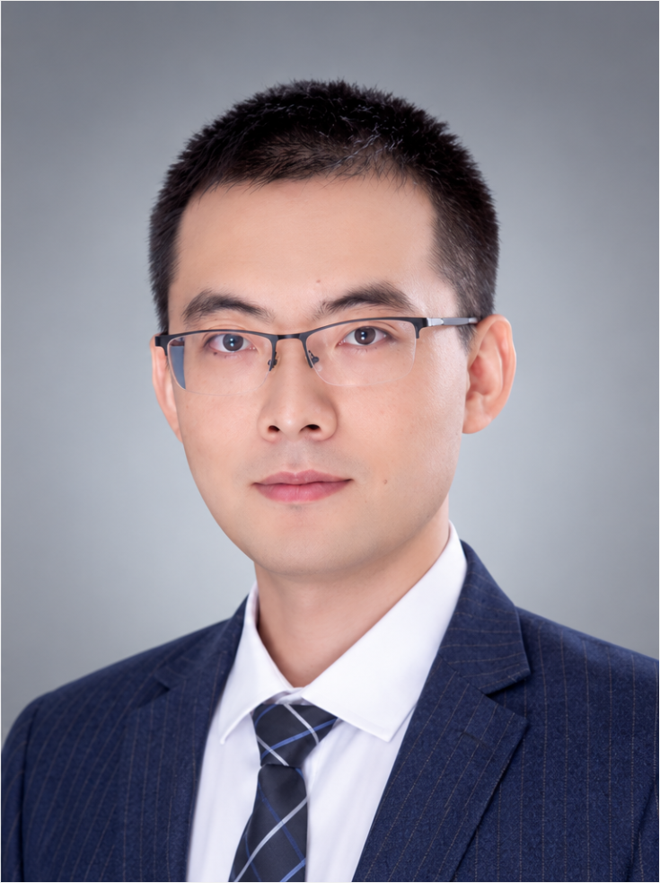

<h2 id="pi-name">Gaofei Wei</h2>
Tenured Associate Professor | Principal Investigator

Dr. Gaofei Wei is a tenured Associate Professor at Northwestern Polytechnical University (NPU). He entered the National Science Foundation Class in Basic Pharmaceutical Sciences at Shenyang Pharmaceutical University in 2006 and began his doctoral studies in 2010 under the supervision of Professor Maosheng Cheng. He received his Ph.D. in 2015. From 2016 to 2019, he worked at the School of Pharmaceutical Sciences, Sun Yat-sen University. In 2019, he joined Northwestern Polytechnical University and established the Cellular Metabolism and Precision Therapeutics (CMPT) Laboratory.

His research focuses on cellular metabolism, immune regulation, and innovative drug development, with particular interests in cancer, sepsis, and cancer cachexia. His laboratory investigates the roles of glucose, pyrimidine, and glutamine metabolism in disease progression and immune regulation. Building on these mechanistic insights, his team develops innovative therapeutic strategies, including immune–metabolic drug conjugates (IMDC), small-molecule prodrugs, proteolysis-targeting chimeras (PROTAC), and immunometabolic nanomedicines, aiming to translate fundamental discoveries in immunometabolism into precision therapeutics.

<a href="https://orcid.org/0000-0001-7180-7176" target="_blank" rel="noopener">ORCID</a> · <a href="https://scholar.google.com/citations?hl=en&amp;user=eU9mCjQAAAAJ" target="_blank" rel="noopener">Google Scholar</a> · <a href="https://webofscience.clarivate.cn/wos/author/record/28605" target="_blank" rel="noopener">Web of Science</a>

<strong>Email:</strong> wei_gaofei@nwpu.edu.cn, weigf0605@163.com

</section>

<section aria-labelledby="lab-members"><h2 id="lab-members">Lab Members</h2>
<article>
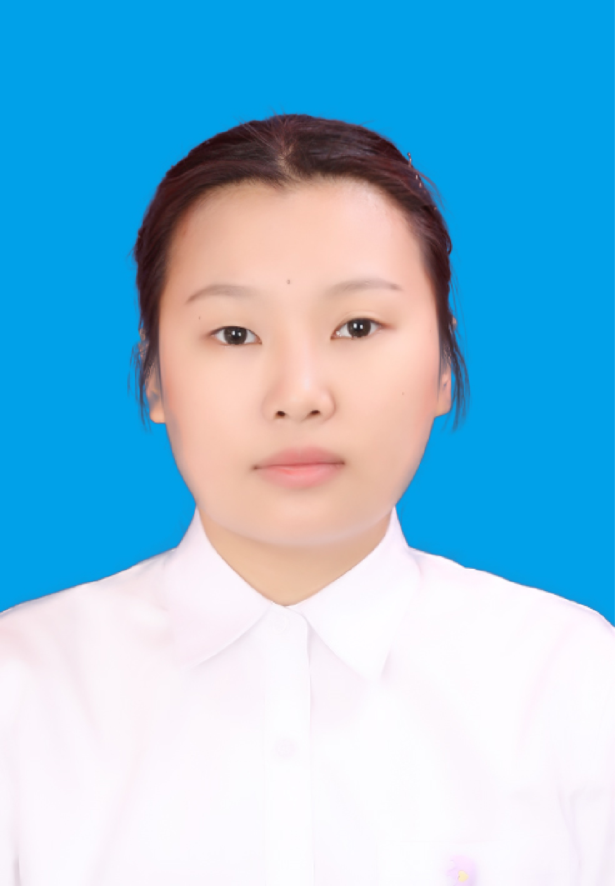
<h3>Renming Fan</h3>
范仁铭

PhD student
</article><article>
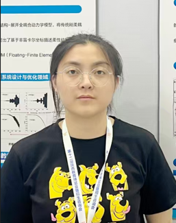
<h3>Yongrui Hai</h3>
海永瑞

PhD student
</article><article>
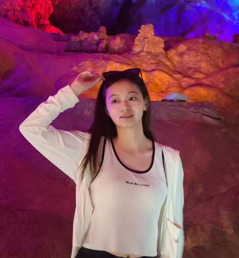
<h3>Xiaolin Liu</h3>
刘晓琳

PhD student
</article><article>
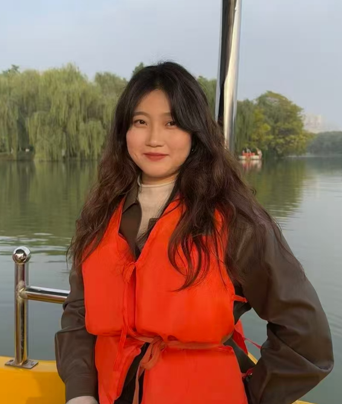
<h3>Yue Chen</h3>
陈悦

PhD student
</article><article>
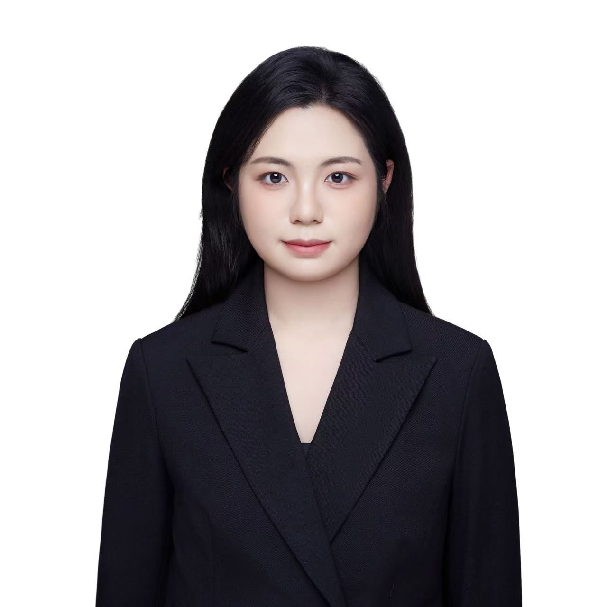
<h3>Ye Chen</h3>
陈烨

PhD student
</article><article>
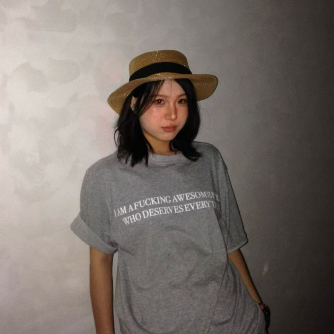
<h3>Jiarui Dou</h3>
窦嘉睿

Master’s student
</article><article>
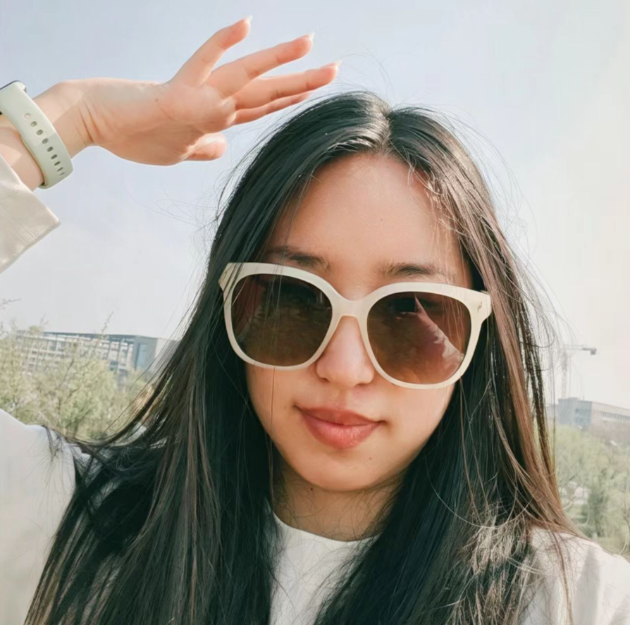
<h3>Jiaxin Yan</h3>
燕佳欣

Master’s student
</article><article>
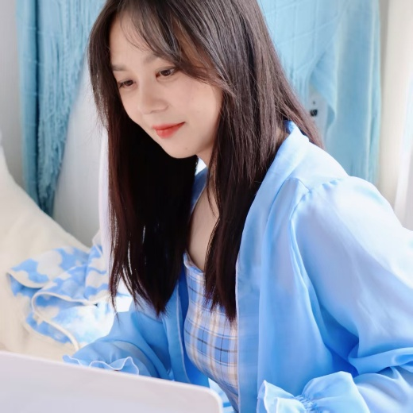
<h3>Chang Wu</h3>
吴畅

Master’s student
</article><article>
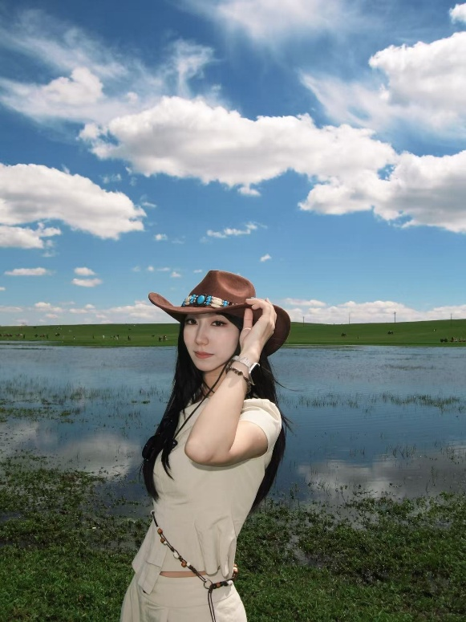
<h3>Xuejing Duan</h3>
段雪菁

Master’s student
</article><article>
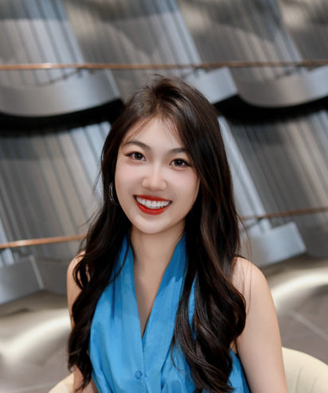
<h3>Jiayi Shen</h3>
申嘉怡

Master’s student
</article><article>
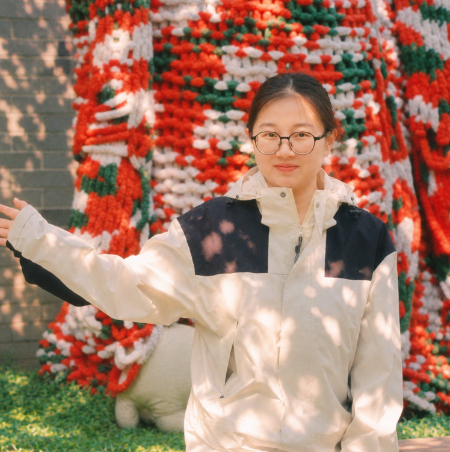
<h3>Xiao Yang</h3>
杨逍

Master’s student
</article><article>
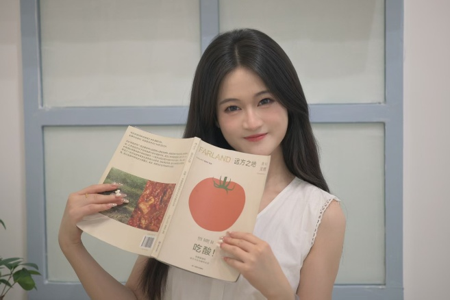
<h3>Liu Zhang</h3>
张柳

Master’s student
</article><article>
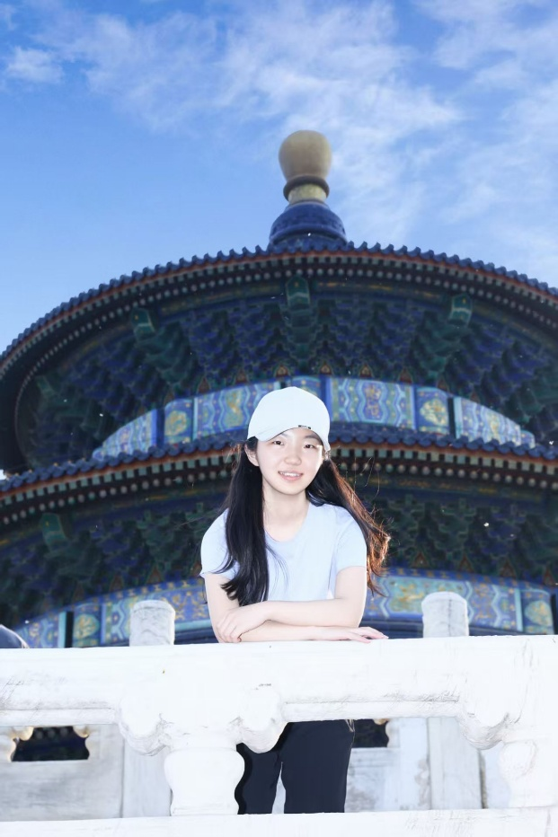
<h3>Xiao Wang</h3>
王潇

Master’s student
</article>
</section>
<section aria-labelledby="alumni"><h2 id="alumni">Alumni</h2><ul class="alumni-grid"><li>Jiakui Gou (<strong lang="zh-CN">芶佳奎</strong>)Master’s · 2019</li><li>Shuo Zhang (<strong lang="zh-CN">张硕</strong>)Master’s · 2019</li><li>Ruoxi Sang (<strong lang="zh-CN">桑若茜</strong>)Master’s · 2020</li><li>Yongqing Liu (<strong lang="zh-CN">刘永青</strong>)Master’s · 2020</li><li>Ruizhuo Lin (<strong lang="zh-CN">蔺锐卓</strong>)Master’s · 2021</li><li>Aohua Deng (<strong lang="zh-CN">邓岙华</strong>)Master’s · 2021</li><li>Ting Zhao (<strong lang="zh-CN">赵婷</strong>)Master’s · 2021</li><li>Junyan Zhuang (<strong lang="zh-CN">庄隽炎</strong>)Master’s · 2022</li><li>Bingjie Zhang (<strong lang="zh-CN">张冰洁</strong>)Master’s · 2023</li><li>Wenhui Wang (<strong lang="zh-CN">王文慧</strong>)Master’s · 2023</li><li>Xintong Lu (<strong lang="zh-CN">陆昕桐</strong>)Master’s · 2023</li></ul></section>

